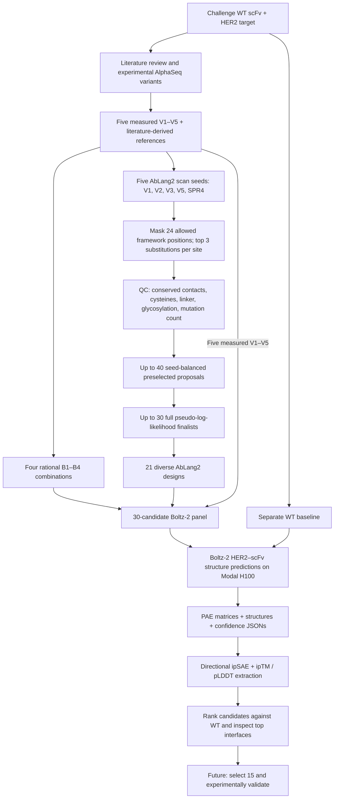

# Trastuzumab scFv Optimization Against HER2

**Adaptyv Bio Zurich Hackathon · Computational antibody engineering · 31 October 2026**

An evidence-guided, reproducible computational workflow for designing and prioritizing **trastuzumab single-chain variable fragment (scFv) variants** against **human HER2/ERBB2**. We combined experimentally characterized sequences and literature-derived mutations with **AbLang2 paired antibody language modeling**, then evaluated a 30-sequence panel using **Boltz-2 complex structure prediction** and **inter-chain predicted aligned error (ipSAE)** scoring.

**Screening outcome:** All **30 candidates** and a separate wild-type (WT) reference were successfully scored. **Eight candidates exceeded WT on `ipsae_min`** in this single-model, empty-MSA screen. The strongest was **`ML_20`** (`ipsae_min = 0.334`, versus WT `0.115`). These are **model confidence metrics, not measurements of binding affinity**.

> **Project status:** Computational sequence generation and the first structure-confidence screen are complete. **No newly designed variants have been experimentally validated in this project.** The 30-candidate screen is an intermediate stage; the hackathon calls for a final selection of **15 unique sequences** for experimental testing.

## Contents

- [Research objective](#research-objective)
- [Pipeline overview](#pipeline-overview)
- [Inputs and evidence](#1-inputs-and-evidence)
- [Constrained sequence design with AbLang2](#2-constrained-sequence-design-with-ablang2)
- [Candidate shortlisting](#3-candidate-shortlisting)
- [Boltz-2 complex prediction](#4-boltz-2-complex-prediction)
- [ipSAE scoring and evaluation](#5-ipsae-scoring-and-evaluation)
- [Results](#results)
- [Reproduce the workflow](#reproduce-the-workflow)
- [Repository structure and outputs](#repository-structure-and-outputs)
- [Interpretation and limitations](#interpretation-and-limitations)
- [Sources and further documentation](#sources-and-further-documentation)

## Research objective

The Adaptyv Bio challenge provided a trastuzumab-derived scFv binding HER2, with a **reported organizer-platform WT `K_D` of 0.82 nM**. The task was to propose affinity-improving variants under the challenge's sequence constraints:

| Requirement | Applied in this project |
|---|---|
| Preserve `VH–(GGGGS)3–VL` organization | Yes |
| At least **5 substitutions** compared with the supplied WT | All 30 shortlisted candidates |
| Maximum sequence length **260 aa** | All designed candidates retained at **242 aa** |
| **15** sequences for final experimental submission | To be selected after the computational screen |

Our additional *design choices* were stricter: no insertions/deletions, maximum **7** substitutions relative to WT, unchanged linker and disulfide residues, protection of selected HER2-contact residues, and at most **one newly proposed framework substitution per AbLang2 seed**.

**Reference construct (242 aa):**

```text
VH (120 aa)                (GGGGS)3 linker (15 aa)              VL (107 aa)
residues 1–120             residues 121–135                   residues 136–242
```

All mutations (e.g. `A23V`, `S211T`) are numbered **1-based along the full 242-aa scFv**, not using Kabat or IMGT numbering. Thus `S211T` corresponds to **VL residue 76**.

For cofolding, the target is the **630-aa HER2 extracellular domain**, corresponding to **UniProt P04626 residues Thr23–Thr652**. The target sequence is defined in [`eval.py`](eval.py).

## Pipeline overview



| Stage | Tool / implementation | Main artifact |
|---|---|---|
| Evidence and seed selection | Literature, AlphaSeq data, `trastuzumab_ablang2_design.py` | `00_reference_sequences.csv` |
| One-site sequence proposals | Paired **AbLang2** | `01_all_model_proposals.csv` |
| Preselection and sequence plausibility | Masked log-odds, AbLang2 confidence, pseudo-log-likelihood | `02_initially_ranked.csv`, `03_pll_finalists.csv` |
| Diversity-aware shortlist | Custom Python selection logic | `04_boltz2_shortlist_30.csv` |
| WT and variant cofolding | **Boltz-2 v2.2.1** on **Modal H100** | `.cif`, PAE `.npz`, confidence `.json` |
| Interface scoring | Custom [`eval.py`](eval.py), inspired by Dunbrack Lab ipSAE | `ranked_ipsae.csv`, `all_model_ipsae.csv` |

### 1. Inputs and evidence

We did **not** generate mutations by randomizing the whole sequence. The starting sequences were:

1. **WT:** the challenge's original 242-aa trastuzumab scFv.
2. **Five measured AlphaSeq-derived multi-mutant sequences (`V1`–`V5`):** experimentally characterized sequence combinations in experiments `YM_0990` and `YM_0989`. Their study-specific `K_D` values and parent controls are recorded in the design script; they are **not numerically comparable** to the organizer's BLI `K_D`.
3. **Affinity-related HCDR3 evidence:** `S97A + D102Y` (`SPR2`), recorded in our evidence mapping from an Absci-associated SPR panel.
4. **Framework-stability evidence:** `S85N + R87T` (`STABILITY2`). This pair was retained **for reference only** because it introduces a potential `N-X-S/T` glycosylation sequon; `R87T` was considered separately when building composite designs.

Four **untested** five-mutation combinations (`B1`–`B4`) were constructed by combining the `SPR4` backbone (`S97A, D102Y, S75D, R87T`) with one additional mutation. `SPR4` itself is a four-mutation **computational seed**, not an experimentally established binder and not an eligible five-mutation submission sequence.

The five sequences scanned by AbLang2 were **`V1`, `V2`, `V3`, `V5`, and `SPR4`**. `V4` was included directly in the fixed shortlist but **not** used as a scan seed.

For exact mutation sets, assay numbers, primary references and evidence-quality caveats, see [Literature and experimental evidence](docs/LITERATURE_AND_EXPERIMENTAL_EVIDENCE.md).

### 2. Constrained sequence design with AbLang2

**Script:** [`trastuzumab_ablang2_design.py`](trastuzumab_ablang2_design.py)

We used the pretrained **`ablang2-paired`** checkpoint. The model saw each candidate as paired **`[VH, VL]`**; the artificial 15-aa scFv linker was omitted from the AbLang2 input and restored unchanged in every final 242-aa sequence.

**Search space and constraints:**

- **24 allowed framework positions** (11 VH + 13 VL), curated to avoid the main HER2-contact surface and antibody structural features:
  - VH: `7, 13, 17, 19, 23, 63, 69, 71, 72, 84, 88`
  - VL, in full-scFv coordinates: `142, 144, 145, 147, 150, 152, 153, 155, 195, 198, 211, 212, 216`
- **Only one new substitution per seed**; all pre-existing seed substitutions were preserved.
- No free CDR scanning; selected **HER2 contact residues**, disulfide cysteines (`22, 96, 158, 223`) and linker residues (`121–135`) were protected.
- New amino acids `C`, `P`, `G` and `W` were excluded at proposed framework sites.
- Reject variants with new `N-X-S/T` glycosylation sequons, changed cysteine count, noncanonical amino acids, altered length/linker, or fewer than 5/more than 7 parent-relative substitutions.

At each seed/position combination, the model masked one residue and scored alternative amino acids in the context of both variable domains. The local ranking statistic was **masked log-odds**:

```text
masked_log_odds = log P(proposed amino acid | masked pair)
                - log P(seed amino acid | masked pair)
```

The pipeline considered the **three highest-ranked alternatives per position** before quality-control filtering. This gives a **maximum of 5 × 24 × 3 = 360 initial proposals**; the actual retained count depends on filtering and deduplication and should be read from `01_all_model_proposals.csv` (not assumed to equal 360).

### 3. Candidate shortlisting

A hierarchical funnel reduced computation and maintained diverse seed backgrounds:

| Filter | Rule | Maximum retained |
|---|---|---:|
| Initial model suggestions | Top 3 nonidentical allowed residues × 24 positions × 5 seeds | **360** proposals, before QC |
| Masked-proposal preselection | Top 8 per seed, prioritizing **distinct edited positions** | **40** |
| Full-model plausibility scoring | Top 6 per seed; compute paired AbLang2 **pseudo-log-likelihood (PLL)** | **30** |
| Diversity selection | Balance seed representation, prefer unused sites, rank by **PLL delta vs seed** | **21** novel ML combinations |
| Add fixed designs | 5 measured AlphaSeq sequences (`V1`–`V5`) + 4 rational sequences (`B1`–`B4`) | **9** |
| **Final structural screening panel** | **21 + 9** | **30** unique candidates |

PLL is assessed **relative to each candidate's own starting seed**, so the model measures whether the added framework substitution looks more or less sequence-plausible on that background. **Positive PLL improvement was not an absolute requirement** for selection; balancing and diversification could retain negative-PLL-delta candidates. No AbLang2 score was interpreted as a binding `K_D` prediction.

The 21 new sequences were labeled `ML_01`–`ML_21` in **selection order**, not in Boltz-2 performance order. The project records the original seed and added mutation for each. See [Sequence generation pipeline](docs/SEQUENCE_GENERATION_PIPELINE.md) for pseudocode-level details and the complete 21-variant provenance table.

### 4. Boltz-2 complex prediction

**Scripts:** [`eval.py`](eval.py) and [`modal_eval.py`](modal_eval.py)

The 30-candidate panel and WT were evaluated **separately** against identical HER2 targets. The scripts generate a Boltz-2 YAML for each complex:

- **Chain A:** 242-aa scFv (`VH–(GGGGS)3–VL`).
- **Chain B:** 630-aa HER2 extracellular domain, residues 23–652.
- **MSA:** explicit `empty` mode for **both chains** in the reported screen (no sequence alignment); an optional `server` setting exists but was not used for the reported comparisons.

**Reported inference settings:**

| Setting | Value |
|---|---|
| Boltz package | `boltz[cuda]==2.2.1` |
| Compute | One NVIDIA **H100** GPU per Modal prediction invocation |
| Recycling steps | **3** |
| Sampling steps | **200** |
| Diffusion samples | **1** per complex |
| Full PAE output | Enabled (`--write_full_pae`) |
| Modal GPU-function timeout | **3,600 s (1 h)** per invocation |
| Prediction persistence | Modal volumes `trastuzumab-boltz-results` and `trastuzumab-boltz-model-cache` |

This is a **self-installed Boltz-2 model executed on rented Modal GPU infrastructure**—**not** a hosted Boltz-2 API and not inference on the user's Mac. The Modal image is built from the script, and input CSVs and evaluation code are uploaded automatically.

Boltz-2 outputs include **predicted structures (`.cif`)**, **PAE matrices (`.npz`)** and **confidence metadata (`.json`)**. Outputs are stored on a persistent Modal volume; ranking CSVs are copied back to the local project. WT prediction files are downloaded by default, while all variant structures/PAE JSONs can be fetched using `--score-only --download-variants` without rerunning GPU inference.

### 5. ipSAE scoring and evaluation

**Scoring:** the project's custom `eval.py` implementation, based on the **Dunbrack Lab ipSAE concept**; it is **not a full reproduction of every feature of the original IPSAE program**.

For each Boltz-2 PAE matrix (expected size **872 × 872** = 242 scFv + 630 HER2 residue tokens), the evaluator:

1. Extracts the **scFv → HER2** and **HER2 → scFv** cross-chain PAE blocks.
2. Retains residue pairs with **PAE < 15 Å**.
3. Computes a directional per-residue confidence contribution `1 / (1 + (PAE / d0(n))²)` with a length-adjusted `d0` based on the count of accepted opposing-chain residues.
4. Takes the maximum per-residue mean score in each direction and defines:

   ```text
   ipsae_min = min(ipsae_ab_to_her2, ipsae_her2_to_ab)
   ipsae_max = max(ipsae_ab_to_her2, ipsae_her2_to_ab)
   ```

5. Reads Boltz confidence JSON values (`iptm`, `protein_iptm`, `complex_plddt`, `confidence_score`) and records predicted file paths.
6. Selects **model index 0** for the summary, rather than cherry-picking the highest ipSAE across samples, then sorts **`ranked_ipsae.csv` by `ipsae_min` descending**.

The two CSV outputs serve different purposes:

- `ranked_ipsae.csv` — **one row per candidate**, ranked with sequence metadata, mutation provenance, ipSAE and confidence metrics.
- `all_model_ipsae.csv` — **one row per scored structure model**, useful when additional models or diffusion samples are run.

**Interpretation:** Higher `ipsae_min` means higher *predicted cross-chain interface confidence* under this score; **it is not a direct estimate of affinity, free energy or `K_D`**. `ipTM` provides an additional model-confidence check. No protein–protein affinity head was used in this evaluation.

## Results

**Observed on the uploaded completed outputs:** `30/30` candidate rows and `1/1` WT row had `status = ok`. **Eight** of the 30 candidate structures achieved `ipsae_min > WT`; **seven** of those eight also exceeded WT in `iptm`.

| ipSAE rank among WT-beating candidates | Candidate | Origin / added AbLang2 mutation | Total WT-relative substitutions | `ipsae_min` | `iptm` |
|---:|---|---|---:|---:|---:|
| 1 | **`ML_20`** | `SPR4` + **`A23V`** | 5 | **0.3340** | **0.7759** |
| 2 | **`ML_16`** | `V2` + **`S211T`** | 6 | **0.2789** | **0.7214** |
| 3 | **`ML_15`** | `SPR4` + **`S211T`** | 5 | **0.2076** | **0.7109** |
| 4 | `ML_06` | `V2` + `N84S` | 6 | 0.1957 | 0.6668 |
| 5 | `ML_01` | `V2` + `A72R` | 6 | 0.1891 | 0.6699 |
| 6 | `ML_11` | `V1` + `N84S` | 7 | 0.1877 | 0.6796 |
| 7 | `ML_12` | `V2` + `A88V` | 6 | 0.1691 | 0.6522 |
| 8 | `V2` | Previously measured AlphaSeq combination | 5 | 0.1346 | 0.6221 |
| — | **WT baseline** | Original challenge sequence | 0 | **0.1145** | **0.6312** |

- **`ML_20`** is the strongest result from this particular Boltz-2/ipSAE screen: its score is approximately **2.92× the WT ipSAEmin**, which **does not** imply a 2.92× improvement in affinity.
- **`ML_16`** adds a light-chain framework mutation (`S211T`) to an experimentally characterized V2 seed.
- **`ML_15`** and **`ML_20`** share the same rational `SPR4` seed and differ in the newly added framework substitution, supporting an informative comparison.
- **`V2`** exceeds WT on ipSAEmin but **not** on ipTM, illustrating why a single metric should not determine the final submission.

**All candidate scores above are predictions from one diffusion sample per complex with empty MSAs.** The 30 models have **not** been experimentally assessed for affinity, specificity, expression, stability or developability in this project.

## Reproduce the workflow

### Prerequisites

- Python **3.10+** for sequence generation; `torch`, `ablang2`, `pandas`, `numpy`.
- A [Modal](https://modal.com/) account configured for GPU inference, with the Modal CLI installed and authenticated.
- The repository scripts and their relative paths as shown below. **`eval.py` and `modal_eval.py` must be alongside `trastuzumab_ablang2_design.py`; CSVs belong inside `ablang2_results/`.**
- Check your **Modal workspace spending controls before launching any H100 jobs**. The 1-hour timeout limits each invocation, **not aggregate charges**.

### A. Generate the reference table and AbLang2 variants (local CPU)

```bash
python -m pip install torch ablang2 pandas numpy modal
modal setup

# Check sequence, positions, seed mutations and constraints without loading model weights
python trastuzumab_ablang2_design.py --dry-run

# Generate proposals, intermediate scores and the 30-candidate shortlist
python trastuzumab_ablang2_design.py --output-dir ablang2_results --device cpu
```

On compatible Apple Silicon installations, `--device mps` may be an option; CPU was the documented safe default. The first model run downloads AbLang2 weights. `--dry-run` validates and writes the reference table/manifest but **does not produce the 30-sequence shortlist**.

### B. Optional: check WT YAML preparation (no GPU)

```bash
python eval.py --wt-only --prepare-only
```

### C. Predict and score the WT baseline on Modal

```bash
modal run modal_eval.py --wt-only
```

Outputs are saved to `boltz_results/empty/wt/`. If prediction succeeds but a later scoring/download step fails, **reuse existing model files rather than immediately rerunning the GPU**:

```bash
modal run modal_eval.py --wt-only --score-only
```

### D. Predict and score 30 designs on Modal

```bash
modal run modal_eval.py --limit 30
```

Outputs are saved to `boltz_results/empty/variants/`. To score cached predictions and retrieve every variant's structure, PAE and confidence files **without requesting a GPU**:

```bash
modal run modal_eval.py --limit 30 --score-only --download-variants
```

**Notes:** `--limit 1` is available as a smaller GPU smoke test; `--no-kernels` disables optional CUDA acceleration if required by an installation problem; `--override` **forces recomputation and additional GPU spending**, so avoid it unless necessary. `--msa-mode server` runs a different protocol and should **not be mixed with the reported empty-MSA results** in a direct comparison.

### E. Review the output

```text
boltz_results/
└── empty/
    ├── wt/
    │   ├── ranked_ipsae.csv
    │   ├── all_model_ipsae.csv
    │   └── boltz_results_*/predictions/WT/...
    └── variants/
        ├── ranked_ipsae.csv
        ├── all_model_ipsae.csv
        └── boltz_results_*/predictions/<variant>/...
```

Boltz's `boltz_results_*` subdirectory name depends on the input batch name. All prediction structures **may initially exist only on the persistent Modal volume** unless explicitly downloaded. Do not assume that an absent local `predictions/` folder means inference failed: inspect the `status` column in `ranked_ipsae.csv` and retrieve the existing files using the score-only download command.

## Repository structure and outputs

Recommended repository organization (**place the two accompanying Markdown documents in `docs/` and commit the generated files you intend to publish**):

```text
.
├── README.md
├── trastuzumab_ablang2_design.py
├── eval.py
├── modal_eval.py
├── docs/
│   ├── LITERATURE_AND_EXPERIMENTAL_EVIDENCE.md
│   └── SEQUENCE_GENERATION_PIPELINE.md
├── ablang2_results/
│   ├── 00_reference_sequences.csv
│   ├── 01_all_model_proposals.csv
│   ├── 02_initially_ranked.csv
│   ├── 03_pll_finalists.csv
│   ├── 04_boltz2_shortlist_30.csv
│   └── manifest.json
└── boltz_results/
    └── empty/
        ├── wt/
        │   ├── ranked_ipsae.csv
        │   └── all_model_ipsae.csv
        └── variants/
            ├── ranked_ipsae.csv
            └── all_model_ipsae.csv
```

The `predictions/` trees (`.cif`, `.npz`, `.json`) may be large. Consider storing large raw outputs in GitHub Releases or an external artifact location rather than committing them all to Git. Keep **the input sequences, scripts, `manifest.json`, and scoring CSVs** versioned for practical reproducibility. For a fully reproducible run, also archive exact Python package versions, AbLang2 checkpoint provenance/checksum, Boltz weights/version, random seeds, Modal configuration and individual prediction artifacts; these are **not all pinned by the current scripts**.

## Interpretation and limitations

- **Experimental provenance ≠ validation of the new designs.** V1–V5 were measured as *whole sequence combinations* in their source assay. B1–B4, SPR4 and ML_01–ML_21 are novel/untested combinations in this project. Published effects of individual substitutions should **not** be assumed additive.
- **Model scores ≠ binding affinity.** AbLang2 masked likelihood/PLL measures learned sequence plausibility; ipSAE and ipTM reflect predicted interface/structure confidence. Neither directly measures `K_D` or binding kinetics.
- **Limited inference sampling.** The reported Boltz-2 run used empty MSAs and **one diffusion sample** per complex; no replicate-based robustness or alternate target/antibody conformational analysis has been established.
- **Predicted binding pose needs inspection.** Compare the antigen-contact patch, CDR arrangement, interfacial geometry and potential clashes against WT, especially for `ML_20`, `ML_16`, `ML_15`.
- **Developability is not established.** Stability, solubility, aggregation, expression and specificity still require evaluation.
- **Study measurements are assay-specific.** AlphaSeq, reported SPR values, and the organizer's BLI parent measurement cannot be directly interchanged.
- **This is not yet the 15-sequence submission.** A final laboratory panel should combine computational rankings with evidence, sequence/structural diversity and further checks.

## Sources and further documentation

### Project-specific documentation

- **[Literature and experimental evidence](docs/LITERATURE_AND_EXPERIMENTAL_EVIDENCE.md)** — AlphaSeq data, affinity/stability mutation references, rationale for rational combinations and evidence limitations.
- **[Detailed sequence generation pipeline](docs/SEQUENCE_GENERATION_PIPELINE.md)** — exact generation code logic, search-site and mutation constraints, AbLang2 scoring funnel and all 21 new ML designs.
- **[`trastuzumab_ablang2_design.py`](trastuzumab_ablang2_design.py)** — executable source of truth for the input sequences and generated shortlist.
- **[`eval.py`](eval.py), [`modal_eval.py`](modal_eval.py)** — executable source of truth for the Boltz-2 settings, scoring math, run commands and Modal download behavior.

### Primary tools and scientific resources

1. [AbLang2 — official implementation](https://github.com/oxpig/AbLang2) and Olsen et al., *Addressing the antibody germline bias and its effect on language models for improved antibody design* (2024), [DOI: 10.1101/2024.02.02.578678](https://doi.org/10.1101/2024.02.02.578678).
2. [Boltz / Boltz-2 — official implementation](https://github.com/jwohlwend/boltz) and the [Boltz-2 technical report](https://doi.org/10.1101/2025.06.14.659707).
3. [Dunbrack Lab ipSAE reference implementation](https://github.com/DunbrackLab/IPSAE).
4. [A-Alpha Bio open AlphaSeq dataset](https://huggingface.co/datasets/aalphabio/open-alphaseq).
5. [Absci-associated antibody design data](https://github.com/AbSciBio/unlocking-de-novo-antibody-design).
6. [Framework-stability study](https://pmc.ncbi.nlm.nih.gov/articles/PMC12269682/).
7. [HER2–trastuzumab Fab crystal structure, PDB 1N8Z](https://www.rcsb.org/structure/1N8Z).
8. [Human HER2/ERBB2, UniProt P04626](https://www.uniprot.org/uniprotkb/P04626).

---

*This repository records a computational hackathon workflow and its preliminary screening results. It does not establish that any new antibody has improved experimental HER2 affinity, and it is not a substitute for laboratory characterization.*
